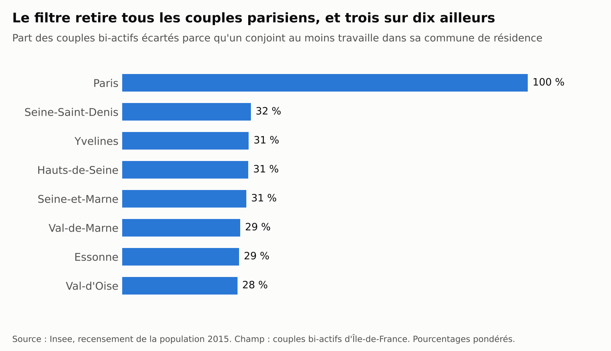
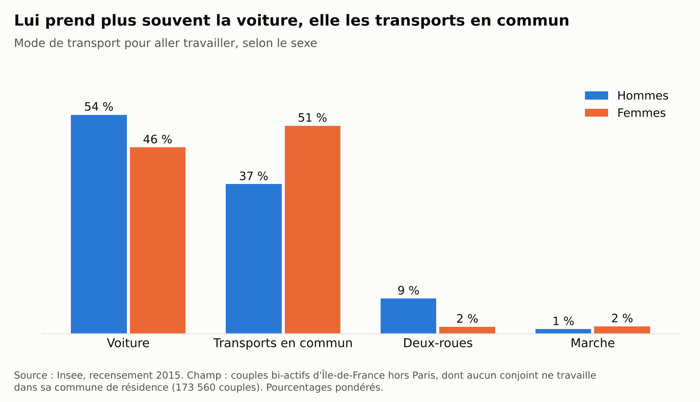
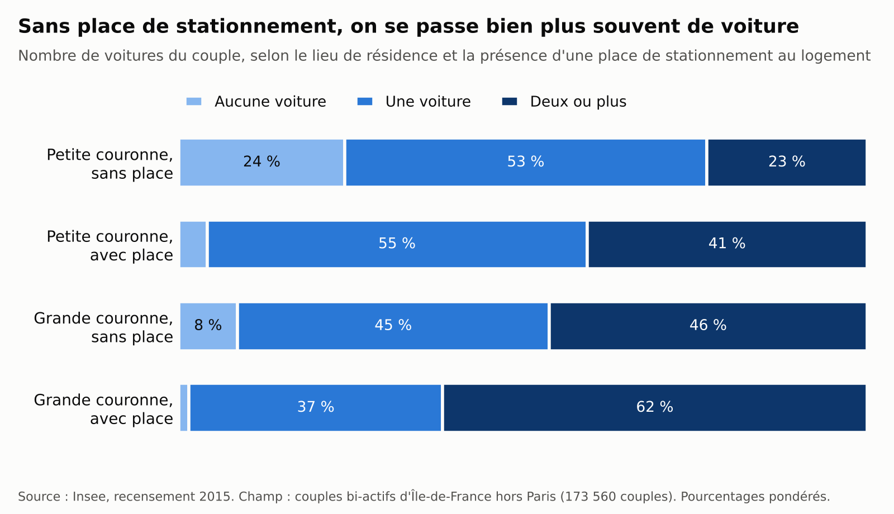
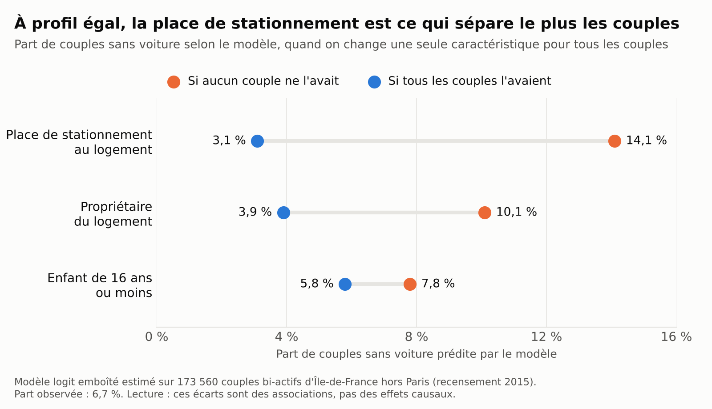

# Aller travailler à deux : qui prend la voiture ?

Cette étude porte sur les trajets domicile-travail des couples d'Île-de-France où les deux conjoints travaillent. Elle répond à deux questions : combien de voitures ont ces couples, et qui la prend pour aller travailler ?

Elle s'appuie sur le recensement de la population de 2015, soit 173 560 couples après nettoyage. Les données sont d'abord décrites, puis analysées avec un modèle de choix discret (un logit emboîté à quatre niveaux) estimé en Python.

La note de synthèse tient en quatre pages : [Note_Mobilite_Couples_Biactifs.pdf](note/Note_Mobilite_Couples_Biactifs.pdf).

## Résultats

### 1. Le nettoyage des données réduit le champ de l'étude

Les temps de trajet ne sont fiables que si le lieu de travail se trouve dans une autre commune que le logement. Il faut donc écarter les couples dont un conjoint travaille dans sa commune de résidence. Ce filtre retire 38 % des couples : tous ceux de Paris, et presque tous ceux qui vont travailler à pied. Les résultats décrivent la banlieue, pas l'Île-de-France entière.



### 2. Lui prend la voiture, elle les transports en commun

54 % des hommes vont travailler en voiture, contre 46 % des femmes. Quand le couple n'a qu'une voiture, lui seul la prend dans 31 % des cas, elle seule dans 18 %. Avec un enfant de moins de six ans, c'est surtout elle qui passe à la voiture.



### 3. La voiture suit la place de stationnement

Sans place de stationnement au logement, 18 % des couples n'ont pas de voiture. Avec une place, ils sont 3 %. L'écart reste le plus marqué de tous quand le modèle tient compte du lieu de résidence, du statut de propriétaire, des enfants et des trajets de chacun.





## Données

Recensement de la population 2015 (Insee), Île-de-France. Le fichier compte une ligne par couple bi-actif, soit 282 271 couples avant nettoyage. Il contient pour chaque conjoint l'âge, la profession, le diplôme, le mode de transport, la commune de travail, la distance et les temps de trajet en voiture et en transports en commun. Tous les pourcentages sont pondérés par les poids du recensement.

Le fichier n'est pas dans le dépôt. Le dossier [`donnees/`](donnees/LISEZ-MOI.md) décrit son contenu.

## Méthode

Le modèle enchaîne quatre décisions, de la plus générale à la plus fine. Chaque niveau transmet au niveau du dessus l'utilité espérée de ses options.

| Niveau | Décision | Variables du couple |
|---|---|---|
| 3 | Avoir une voiture, ou aucune | Enfant de 16 ans ou moins, propriété du logement, place de stationnement, grande couronne |
| 2 | En avoir une ou deux | Les quatre mêmes variables |
| 1 | Qui prend la voiture : les deux, lui, elle, aucun | Enfant de moins de 6 ans, écart de diplôme entre les conjoints |
| 0 | Sans voiture : transports en commun, marche ou deux-roues | Âge, statut de cadre |

À chaque niveau s'ajoutent les temps de trajet et les distances de chaque conjoint.

L'estimation se fait par maximum de vraisemblance, niveau par niveau. Les gradients et la matrice hessienne sont calculés par différentiation automatique (PyTorch), en double précision. Le programme vérifie que chaque paramètre est identifié avant d'en donner l'écart-type. À chaque niveau, un test du rapport de vraisemblance compare le modèle complet à un modèle de base sans les variables du couple : elles améliorent l'ajustement partout (p < 0,001).

L'architecture du modèle (quatre décisions emboîtées, choix joint du couple) et le fichier de données viennent d'un cours de mon master. Le contrôle des données, le programme d'estimation, le choix des variables et l'analyse sont de moi.

## Limites

- **Un champ réduit.** Le filtre écarte Paris et les trajets courts. Les résultats valent pour des couples de banlieue qui travaillent hors de leur commune.
- **Des associations, pas des causes.** Un couple qui tient à sa voiture cherche un logement avec une place de stationnement : le lien joue dans les deux sens.
- **On ne sait pas qui conduit qui.** Quand les deux conjoints vont travailler en voiture, le recensement ne dit pas s'ils partagent le véhicule. Quatre paramètres du niveau 1 sont donc fixés à zéro.
- **Une estimation par étapes.** Les écarts-types des niveaux supérieurs ignorent l'incertitude des niveaux inférieurs. Ils sont trop petits.
- **Le partage des décisions dans le couple.** Le modèle prévoit un poids pour les préférences de chaque conjoint. Estimé selon l'écart de diplôme, il varie peu et pas dans un sens cohérent. Je n'en tire pas de conclusion.
- **Des données de 2015,** sans revenus ni coûts de transport.

## Organisation du dépôt

| Fichier | Contenu |
|---|---|
| `code/01_preparer_decrire.py` | Contrôle du filtre, variables du modèle, tableaux descriptifs |
| `code/02_estimer.py` | Estimation des quatre niveaux, modèle de base puis modèle complet |
| `code/03_lire_resultats.py` | Prédictions du modèle et figures |
| `code/modele.py` | Les fonctions de vraisemblance des quatre niveaux |
| `code/outils_estimation.py` | Maximum de vraisemblance, écarts-types, test du rapport de vraisemblance |
| `resultats/coefficients.csv` | Tous les coefficients et leurs écarts-types |
| `resultats/qualite_ajustement.csv` | Vraisemblance, convergence et tests, niveau par niveau |
| `resultats/journal_estimation.txt` | Ce que le script d'estimation affiche quand il tourne |
| `resultats/*.csv` | Les tableaux descriptifs et les prédictions repris dans la note |
| `figures/` | Les quatre figures |
| `note/` | La note de synthèse |

## Refaire les calculs

Il faut Python 3 et les paquets de `requirements.txt`. Une fois le fichier de données placé dans `donnees/`, les trois scripts se lancent dans l'ordre depuis la racine du dépôt. L'estimation prend quelques minutes sur un ordinateur portable.

```
pip install -r requirements.txt
python code/01_preparer_decrire.py
python code/02_estimer.py
python code/03_lire_resultats.py
```

## Auteur

Guillaume Bousson, diplômé du master Statistique et économétrie de l'Université de Strasbourg.
